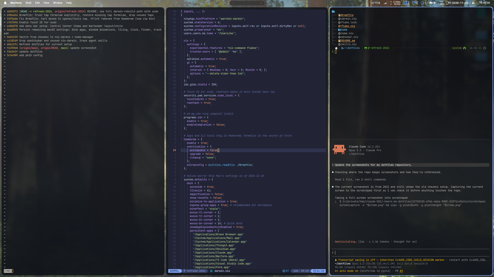

# My Dotfiles

macOS setup managed with [nix-darwin](https://github.com/nix-darwin/nix-darwin) and [home-manager](https://github.com/nix-community/home-manager). Apps still come from Homebrew, driven by the `Brewfile` through nix-darwin.

## Layout

| Path | What it does |
| --- | --- |
| `flake.nix` | Inputs (nixpkgs, nix-darwin, home-manager, skill repos) and the `mbp` host |
| `darwin.nix` | macOS system settings (Dock, Finder, keyboard, trackpad, …), Nix settings, Homebrew |
| `menubar.nix` | Control Center menu bar items and Bartender layout/style (allowlisted keys only) |
| `home.nix` | Symlinks `home/` into `$HOME`; clones oh-my-zsh, powerlevel10k, zsh-autosuggestions, tpm on first run |
| `skills.nix` | Agent skills linked into `~/.agents/skills` and `~/.claude/skills` |
| `Brewfile` | Taps, formulae and casks |
| `home/` | The actual config files, laid out like `$HOME` |

Configs in `home/` are linked out of the Nix store, so editing them in `~/dotfiles` takes effect immediately without a rebuild.

## Fresh machine

```sh
# 1. Install Nix (https://nixos.org/download) and Homebrew (https://brew.sh)
# 2. Clone into ~/dotfiles (home.nix expects this path)
git clone https://github.com/sq3/dotfiles ~/dotfiles
# 3. nix-darwin refuses to overwrite files the Nix installer created
sudo mv /etc/zshrc /etc/zshrc.before-nix-darwin
sudo mv /etc/bashrc /etc/bashrc.before-nix-darwin
sudo mv /etc/nix/nix.conf /etc/nix/nix.conf.before-nix-darwin
# 4. First activation
sudo nix --extra-experimental-features 'nix-command flakes' run nix-darwin -- switch --flake ~/dotfiles#mbp
```

Existing files in `$HOME` that home-manager would replace are renamed to `*.before-hm`.

## Day to day

```sh
sudo darwin-rebuild switch --flake ~/dotfiles#mbp   # apply changes
nix flake update                                    # update nixpkgs, modules and skills
brew bundle dump --file=~/dotfiles/Brewfile --force # after installing apps by hand
```

Secrets are never committed; they come from 1Password (`op`) at runtime.

## Screenshot

